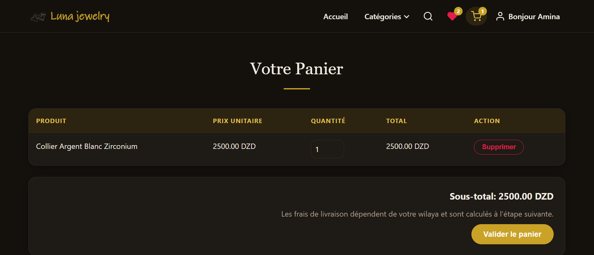
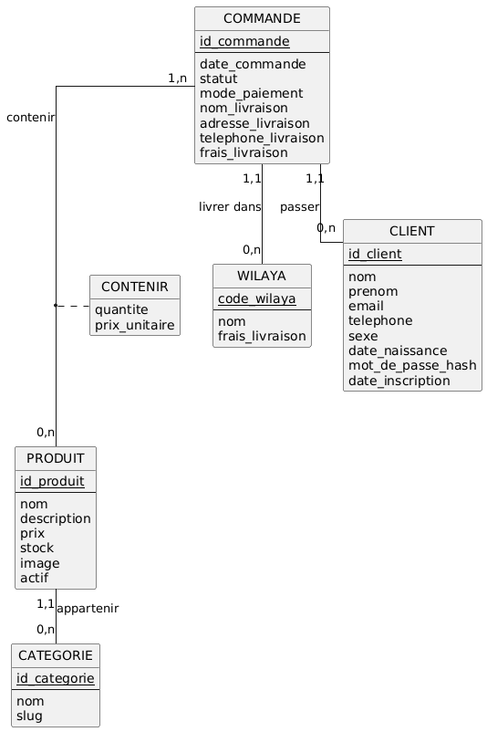
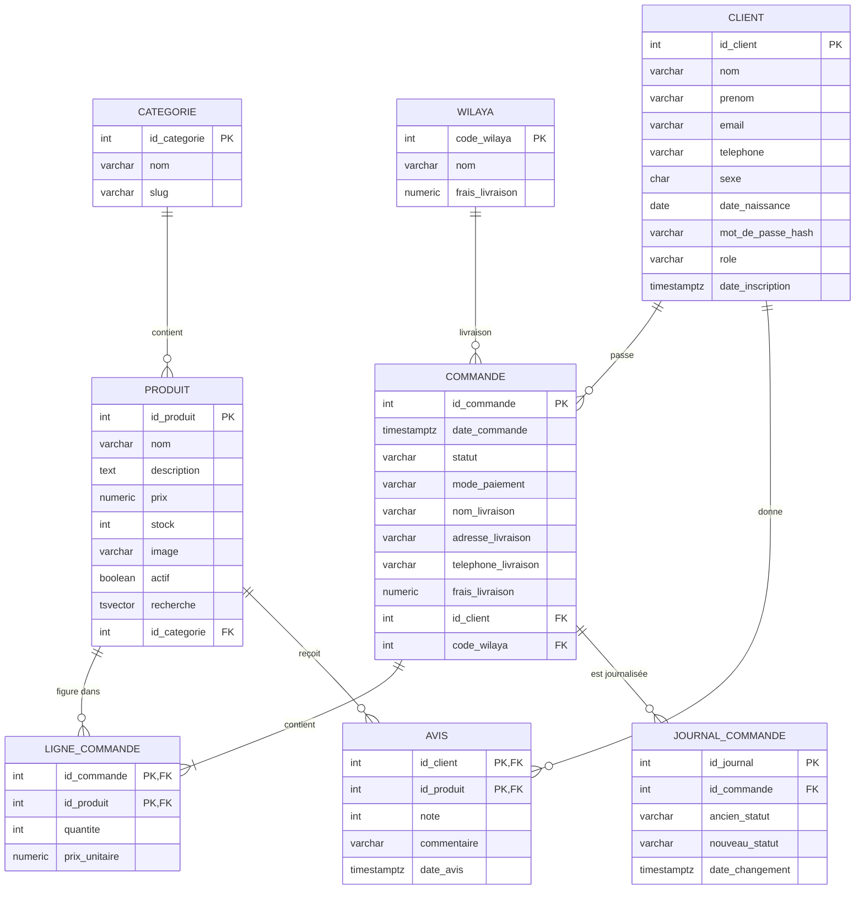

# Luna Jewelry

[](https://github.com/lina77b/luna-jewelry/actions/workflows/ci.yml)


Boutique en ligne de bijoux (bagues, boucles d'oreilles, colliers, bracelets) construite autour d'une base de données **PostgreSQL 16**. C'est un projet universitaire de bases de données de niveau L3 : le site est volontairement simple (Node/Express, HTML/CSS/JS pur, SQL écrit à la main, aucun ORM) pour que le travail porte sur la base.

## Sommaire

1. [Aperçu](#aperçu)
2. [Fonctionnalités](#fonctionnalités)
3. [Ce que montre la base de données](#ce-que-montre-la-base-de-données)
4. [Technologies](#technologies)
5. [Démarrage rapide](#démarrage-rapide)
6. [Structure du projet](#structure-du-projet)
7. [Comptes de démonstration](#comptes-de-démonstration)
8. [Conception de la base de données](#conception-de-la-base-de-données)
9. [Sécurité](#sécurité)
10. [Performances](#performances)
11. [API](#api)
12. [Tests](#tests)
13. [Dépannage Docker](#dépannage-docker)
14. [Hypothèses et limites](#hypothèses-et-limites)
15. [Pistes d'amélioration](#pistes-damélioration)
16. [Crédits et licence](#crédits-et-licence)

## Aperçu




## Fonctionnalités

- Catalogue de 32 bijoux, avec recherche plein texte, tri, filtres (prix, en stock) et pagination calculés en SQL.
- Favoris (icône cœur dans l'en-tête, qui se remplit dès qu'un bijou est ajouté) et panier (icône sur chaque carte).
- Inscription et connexion, avec des mots de passe hachés par bcrypt et des sessions stockées dans PostgreSQL.
- Commande en quatre étapes : panier, livraison, paiement, confirmation. Les prix sont toujours relus dans la base, jamais envoyés par le navigateur.
- Les comptes administrateur ne peuvent ni commander ni donner d'avis, et leur menu n'affiche ni panier ni favoris.
- Page « Mes commandes » : historique, annulation (le stock est remis) et bouton « Commander à nouveau ».
- Avis sur les produits commandés, avec une note de 1 à 5.
- Page d'administration réservée au rôle `admin` : graphiques Chart.js, stock faible, changement de statut des commandes et journal des statuts.
- Thème clair et sombre selon le réglage du système, chargement différé des images et squelettes de chargement.

## Ce que montre la base de données

| Fonctionnalité | Fichier | Description |
|---|---|---|
| `passer_commande(...)` | `functions.sql` | Une transaction : fusion des doublons, verrouillage des produits `FOR UPDATE` dans l'ordre des identifiants pour éviter les interblocages, refus des produits inconnus ou inactifs, refus si le stock est insuffisant (tout est annulé), prix lu dans `produit`, décrément du stock. |
| `annuler_commande(id)` | `functions.sql` | Une transaction : verrouille la commande, remet le stock et passe le statut à `annulee`. Elle est refusée une fois la commande expédiée. |
| Machine à états | `functions.sql` | Un déclencheur `BEFORE UPDATE OF statut` n'autorise que les transitions `en_attente → confirmee → expediee → livree`, et `annulee` uniquement depuis `en_attente` ou `confirmee`. |
| Audit | `functions.sql` | Un déclencheur `AFTER UPDATE OF statut` remplit `journal_commande` avec l'ancienne valeur, la nouvelle valeur et la date. |
| Gel des lignes | `functions.sql` | Une ligne de commande ne se modifie plus dès que la commande n'est plus `en_attente`. |
| `get_identifiants(email)` | `functions.sql` | Fonction `SECURITY DEFINER` qui renvoie le hash d'un seul compte, pour que le rôle applicatif n'ait pas à lire la table `client`. |
| Vues | `views.sql` | `v_total_commande`, `v_meilleures_ventes`, `v_stock_faible` et `v_note_produit` (moyenne des avis). |
| Vue matérialisée | `views.sql` | `mv_ca_mensuel` donne le chiffre d'affaires par mois et se rafraîchit avec `REFRESH MATERIALIZED VIEW`. |
| Recherche plein texte | `schema.sql` | Colonne `tsvector` générée, index GIN et recherche par préfixe en français (`to_tsquery('french', 'bagu:*')`). |
| Sécurité par ligne (RLS) | `roles.sql` | Avec l'utilisateur `luna_app`, un client ne lit que ses commandes et leurs lignes, et l'administrateur lit tout. L'identité est transmise par `set_config('app.id_client', ...)` dans une transaction. |
| Droits minimaux | `roles.sql` | `luna_app` n'écrit pas directement dans `produit` et n'a accès qu'à certaines colonnes de `client`. Les écritures passent par des fonctions `SECURITY DEFINER`. |
| 14 requêtes d'analyse | `queries.sql` | Jointures, `GROUP BY`/`HAVING`, sous-requêtes, `LEFT JOIN ... IS NULL`, CTE et fonctions de fenêtre (`ROW_NUMBER`, `RANK`, `SUM() OVER`, `LAG`). |
| Diagnostic | `diagnostic.sql` | Requêtes les plus lentes (`pg_stat_statements`), usage des index et des parcours séquentiels. |

Les quatorze requêtes de `queries.sql`, dans l'ordre : produits actifs par catégorie ; nombre et prix moyen par catégorie ; catégories dont le prix moyen dépasse 2500 DZD ; produits plus chers que la moyenne ; produits jamais vendus ; dix dernières commandes avec client et wilaya ; chiffre d'affaires par mois ; chiffre d'affaires par wilaya ; clients ayant plusieurs commandes ; panier moyen par mode de paiement ; trois meilleurs produits par catégorie (`ROW_NUMBER`) ; chiffre d'affaires mensuel cumulé et variation (`SUM OVER`, `LAG`) ; classement des clients par dépenses (`RANK`) ; clients dépensant plus que la moyenne (CTE).

## Technologies

Node.js 18 ou plus, Express, `pg`, bcryptjs, express-session, connect-pg-simple, helmet, express-rate-limit et dotenv. Docker sert uniquement à faire tourner PostgreSQL. L'application Node tourne sur la machine avec `npm start`.

## Démarrage rapide

Prérequis : Node.js 18 ou plus et Docker (démarré). Sous Windows, utiliser Git Bash. À la racine du projet :

```bash
cp .env.example .env
npm install
npm run db:up
npm run db:setup
npm run db:demo
npm start
```

Le site est alors disponible sur http://localhost:3000.

Le fichier `.env.example` fait tourner le site avec l'utilisateur à droits limités `luna_app`, ce qui active la sécurité par ligne. Le compte propriétaire `luna` sert uniquement aux scripts `db:*` et aux données de test, par la variable `DATABASE_ADMIN_URL`.

| Commande | Rôle |
|---|---|
| `npm run db:up` | Démarre PostgreSQL dans Docker (port 5433 sur la machine). |
| `npm run db:down` | Arrête le conteneur sans effacer les données. |
| `npm run db:psql` | Ouvre une console `psql` dans le conteneur. |
| `npm run db:setup` | Crée le schéma, les fonctions, les vues, charge le catalogue, puis crée l'utilisateur `luna_app` et active la sécurité par ligne. |
| `npm run db:demo` | Ajoute 6 comptes et 25 commandes de démonstration. |
| `npm run db:bench` | Ajoute environ 5 000 clients et 50 000 commandes pour mesurer les performances. |
| `npm run db:roles` | Réapplique les droits de `luna_app` et les politiques de sécurité par ligne. |
| `npm run db:stats` | Affiche les requêtes les plus lentes et l'usage des index (`pg_stat_statements`). |
| `npm run db:reset` | Efface tout le schéma ; relancer ensuite `db:setup`. |
| `npm test` | Lance les tests. |

Pour exécuter les 14 requêtes d'analyse :

```bash
docker compose exec -T db psql -U luna -d luna < database/queries.sql
```

## Structure du projet

```
luna-jewelry/
  public/        site (pages, style, javascript, images)
  server/        Express : server.js, db.js, routes/, middleware/
  database/      schema.sql, functions.sql, views.sql, seed.sql, roles.sql,
                 demo_data.sql, bench_data.sql, queries.sql, diagnostic.sql
  scripts/       setup-db.js (exécute les fichiers SQL)
  tests/         tests node:test
  docs/          resultats.md (sorties brutes), images/ (MCD et captures)
  .github/       workflows/ci.yml (tests sur chaque push)
  docker-compose.yml  .env.example  package.json  LICENSE
```

## Comptes de démonstration

Après `npm run db:demo`, tous les comptes ont le mot de passe `Demo@2025`.

| E-mail | Rôle |
|---|---|
| `amina.benali@example.com` | client |
| `yacine.khelifi@example.com` | client |
| `lina.mansouri@example.com` | client |
| `sofiane.haddad@example.com` | client |
| `meriem.bouzid@example.com` | client |
| `admin@example.com` | administrateur |

Pour promouvoir un compte existant, le compte propriétaire exécute :

```sql
UPDATE client SET role = 'admin' WHERE lower(email) = 'votre@email.com';
```

## Conception de la base de données

### MCD

Le MCD ci-dessous représente le modèle de départ. Les ajouts décrits plus bas (rôle, recherche, journal, avis) figurent dans le MLD.



### MLD

Le schéma suivant est le modèle logique final, tel que créé par `schema.sql`.



### Ajouts par rapport au modèle de départ

| Ajout | Détail |
|---|---|
| `CLIENT.role` | `'client'` ou `'admin'` (contrainte `CHECK`), pour protéger la page d'administration. |
| `PRODUIT.recherche` | Colonne `tsvector` générée (nom et description), indexée en GIN, pour la recherche plein texte. |
| `JOURNAL_COMMANDE` | Audit des changements de statut, rempli par un déclencheur. |
| `AVIS` | Association plusieurs-à-plusieurs entre client et produit, avec une clé primaire composée et `CHECK (note BETWEEN 1 AND 5)`. |
| `SESSION (sid, sess, expire)` | Table technique de `connect-pg-simple`, hors modèle métier. |

### Choix de conception

- Clés `SERIAL`, montants en `NUMERIC(10,2)` et jamais de flottant.
- Aucune colonne de total ni d'âge : ce sont des valeurs dérivées, calculées par la vue `v_total_commande`.
- `ON DELETE RESTRICT` de la commande vers client et wilaya, et de la ligne vers le produit ; `ON DELETE CASCADE` de la ligne vers sa commande. Un produit vendu est masqué avec `actif`, jamais supprimé.
- Contraintes `CHECK` : prix et stock positifs, quantité strictement positive, code wilaya entre 1 et 58, téléphone de 10 chiffres, sexe `F` ou `M`, date de naissance non future, modes de paiement et statuts énumérés.
- Unicité de l'e-mail sans tenir compte de la casse, avec un index unique sur `lower(email)`.
- Index sur `commande(id_client)`, `commande(date_commande)`, `produit(id_categorie)`, `avis(id_produit)`, `journal_commande(id_commande)` et un index GIN sur `produit(recherche)`.

## Sécurité

- **Moindre privilège.** Le site se connecte avec `luna_app`, qui ne possède aucune table. Les propriétaires de tables contournent la sécurité par ligne, donc le site ne doit jamais tourner avec le compte `luna`.
- **Droits par colonne.** `luna_app` ne peut lire que `id_client`, `nom`, `prenom`, `email` et `role` dans `client`, jamais `mot_de_passe_hash`. À l'inscription, il ne peut pas renseigner `role`, qui vaut toujours `client`.
- **Connexion.** Le hash d'un compte n'est accessible que par `get_identifiants(email)`. Un hash factice est comparé quand l'e-mail n'existe pas, pour que le temps de réponse ne révèle pas quels comptes existent.
- **Sécurité par ligne.** Un client ne voit que ses commandes ; l'administrateur voit tout. Les fonctions `SECURITY DEFINER` fixent leur `search_path`.
- **Limitation des tentatives.** La connexion est bloquée après 10 échecs en 15 minutes pour une même adresse IP, et l'inscription après 10 créations en 15 minutes. La réponse est alors un code 429.
- **En-têtes HTTP.** `helmet` ajoute les en-têtes de sécurité et une politique de contenu qui n'autorise les scripts que depuis le site et depuis `cdn.jsdelivr.net` (Chart.js).
- **Session.** Le cookie est `httpOnly`, `SameSite=Lax` et `secure` en production. Le serveur refuse de démarrer en production si `SESSION_SECRET` vaut `change-me` ou compte moins de 32 caractères ; en développement, il affiche un avertissement.
- **Requêtes.** Toutes les requêtes sont paramétrées et le front n'utilise jamais `innerHTML`.

Pour générer un secret de session :

```bash
node -e "console.log(require('crypto').randomBytes(32).toString('hex'))"
```

Les mots de passe `Demo@2025`, `luna_dev_password` et `luna_app_password` sont réservés au développement. Ils doivent être changés avant toute mise en ligne.

## Performances

Mesures faites avec `EXPLAIN (ANALYZE, BUFFERS)` après `npm run db:bench` (environ 50 000 commandes et 200 000 lignes), sur un PostgreSQL 16 installé directement, hors Docker. Les durées dépendent de la machine : elles servent à comparer des plans. Les sorties complètes sont dans [`docs/resultats.md`](docs/resultats.md).

| Mesure | Sans | Avec |
|---|---|---|
| Commandes d'un client, index `idx_commande_client` | 3,88 ms (`Seq Scan`) | 0,115 ms (`Bitmap Index Scan`) |
| Chiffre d'affaires d'un mois, index `idx_commande_date` | 36,2 ms | 33,5 ms |
| Chiffre d'affaires mensuel : requête sur la vue ou lecture de `mv_ca_mensuel` | 192 ms | 0,083 ms |
| Rafraîchissement de `mv_ca_mensuel` | | environ 147 à 156 ms |
| Page 2000 : `OFFSET 40000` ou pagination par curseur | 16,2 ms | 0,097 ms |

Ce qu'on en retient :

- L'index sur le client est le gain évident : le planificateur passe d'un parcours complet de la table à un accès par index.
- L'index sur la date est utilisé, mais change peu le résultat. Il réduit la lecture de `commande`, mais la requête lit ensuite toutes les lignes de `ligne_commande` (parcours séquentiel de 200 000 lignes), qui domine le temps.
- La vue matérialisée transforme une agrégation de 192 ms en une lecture de 25 lignes. Elle coûte un rafraîchissement d'environ 150 ms : elle est rentable dès que la lecture est plus fréquente que le rafraîchissement, d'où le bouton de rafraîchissement dans la page d'administration.
- La pagination par curseur (`WHERE (date_commande, id_commande) < (...)`) garde un coût constant, alors que `OFFSET` relit et jette toutes les lignes précédentes. Le curseur est utilisé par la liste des commandes de l'administration (« Charger plus ») ; `OFFSET`/`LIMIT` est utilisé pour les produits.
- Avec seulement 32 produits, le planificateur choisit un parcours séquentiel pour la recherche plein texte. L'index GIN est bien utilisable (démonstration avec `SET enable_seqscan = off`) et deviendrait déterminant sur un catalogue important.
- Avec `pg_stat_statements` (`npm run db:stats`), les requêtes les plus coûteuses sont des agrégations complètes sur `v_total_commande` (moyenne de 117 à 185 ms). Aucun index ne les accélère, car elles doivent lire toutes les commandes et toutes les lignes ; la piste est de matérialiser d'autres agrégats, comme pour le chiffre d'affaires mensuel. L'usage des index le confirme : `idx_produit_categorie` n'est jamais utilisé, car la table `produit` ne contient que 32 lignes.

## API

Toutes les réponses sont en JSON ; les erreurs ont la forme `{ "erreur": "..." }` en français.

| Méthode et chemin | Accès | Rôle |
|---|---|---|
| `GET /api/categories` | public | Liste des catégories. |
| `GET /api/wilayas` | public | Wilayas et frais de livraison. |
| `GET /api/produits` | public | Produits actifs ; paramètres `categorie`, `ids`, `q` (recherche), `tri` (`prix_asc`, `prix_desc`, `nom`, `note`), `prix_min`, `prix_max`, `en_stock=1`, `limite`, `page`, `apres` (curseur) ; en-tête `X-Total-Count`. |
| `GET /api/produits/:id/avis` | public | Avis d'un produit. |
| `POST /api/produits/:id/avis` | connecté | Donner ou modifier son avis (produit commandé uniquement). |
| `POST /api/auth/register` | public | Inscription (409 si l'e-mail existe). |
| `POST /api/auth/login` | public | Connexion. |
| `POST /api/auth/logout` | connecté | Déconnexion. |
| `GET /api/auth/me` | public | `null` ou `{ id, prenom, nom, role }`. |
| `POST /api/commandes` | connecté | Passer commande (409 si stock insuffisant). |
| `GET /api/commandes/moi` | connecté | Mes commandes avec leurs lignes. |
| `POST /api/commandes/:id/annuler` | connecté | Annuler sa commande. |
| `GET /api/admin/stats` | admin | Données des graphiques. |
| `GET /api/admin/commandes` | admin | Commandes (pagination par curseur, filtre `statut`). |
| `PATCH /api/admin/commandes/:id/statut` | admin | Changer le statut (409 si transition interdite). |
| `GET /api/admin/commandes/:id/journal` | admin | Journal des statuts. |
| `POST /api/admin/rafraichir` | admin | Rafraîchir la vue matérialisée. |

Aucun numéro de carte n'est stocké : seul le mode de paiement choisi l'est.

## Tests

```bash
npm test
```

Cinq fichiers `node:test` sont lancés l'un après l'autre :

- `api.test.js` : inscription, connexion, déconnexion, e-mail en double, catalogue, recherche, tri, filtres, pagination, avis, commande, stock insuffisant, annulation, droits d'administration, transitions de statut et journal. L'application y tourne avec `luna_app`.
- `fonctions.test.js` : `passer_commande` (succès, annulation complète, produit inactif ou inconnu), `annuler_commande`, machine à états, journal et contraintes.
- `concurrence.test.js` : deux connexions `luna_app` commandent en même temps la dernière unité d'un produit ; une seule réussit et le stock finit à 0.
- `rls.test.js` : isolation des commandes par client, accès administrateur, refus de lecture du hash et refus d'insérer un rôle, et `get_identifiants`.
- `limites.test.js` : blocage à la onzième tentative de connexion échouée et présence des en-têtes de sécurité.

Les mêmes tests tournent à chaque push avec GitHub Actions (`.github/workflows/ci.yml`), sur un PostgreSQL 16 lancé par Docker. En local, ils exigent une base initialisée (`npm run db:setup`). Le compte de `DATABASE_ADMIN_URL` prépare et nettoie les données, et celui de `DATABASE_URL` fait tourner l'application.

## Dépannage Docker

- **« cannot connect to the Docker daemon »** : Docker n'est pas démarré.
- **« port is already allocated »** : le port 5433 est pris. Changer `"5433:5432"` dans `docker-compose.yml` et le port dans `DATABASE_URL` et `DATABASE_ADMIN_URL`.
- **« connection refused » juste après le démarrage** : `db:setup` réessaie pendant 30 secondes ; sinon attendre l'état *healthy* dans `docker compose ps`.
- **`docker compose down -v` supprime les données** : utiliser `npm run db:down`, qui arrête seulement le conteneur.
- **Sauvegarde et restauration** : à lancer dans Git Bash et non dans PowerShell, qui abîme la redirection binaire.

```bash
docker compose exec -T db pg_dump -U luna -Fc luna > luna.dump
docker compose exec -T db pg_restore -U luna -d luna --clean --if-exists --no-owner < luna.dump
```

## Hypothèses et limites

- Le stock initial est de 20 unités par produit.
- Les frais de livraison sont de 500 DZD pour les 58 wilayas ; ils sont lus dans la table `wilaya`.
- Il faut être connecté pour commander.
- Les favoris et le panier sont stockés dans le navigateur (`localStorage`), pas dans la base : le modèle de départ n'a pas de table pour eux.
- Le bouton Google de la page de connexion est un simple élément d'interface.
- Les données de `bench_data.sql` sont insérées directement, sans passer par `passer_commande` : le stock n'est donc pas décrémenté.
- Les graphiques de la page d'administration utilisent Chart.js chargé depuis un CDN ; sans connexion internet, la page affiche un message à la place des graphiques.
- La limitation des tentatives est comptée en mémoire, par adresse IP, et repart de zéro à chaque redémarrage du serveur.

## Pistes d'amélioration

- Verrouiller un compte après plusieurs échecs, avec des colonnes dédiées dans `client`.
- Vérifier les mots de passe dans PostgreSQL avec `pgcrypto`, pour que le hash ne quitte jamais la base.
- Héberger Chart.js dans `public/` pour retirer la dépendance au CDN.
- Stocker les favoris et le panier en base.
- Ajouter un système de migrations.

## Crédits et licence

Projet réalisé par [lina77b](https://github.com/lina77b). Le code est publié sous licence MIT (voir [`LICENSE`](LICENSE)).

C'est un projet pédagogique sans but commercial. Les photographies de produits sont fournies à titre d'illustration et doivent être remplacées par des images dont on détient les droits avant tout usage commercial. Les descriptions de produits ne citent aucune marque.

